# ParfumCreator

Aplikasi Android local-first untuk meracik parfum dari bahan natural (essential oil, absolut, resin) dan fragrance oil katalog (Luzi, Parfarome, Macrabame), dilengkapi kalkulator formula native C++17, RAG dokumen lokal, model AI on-device Gemma 4 (LiteRT-LM), serta pencarian web opt-in bersitasi.

Versi terbaru: **v1.3.1** (versionCode 5) | Android 8.0+ (API 26) | Kotlin, Jetpack Compose, Material 3, Android NDK (C++17)

## Unduh APK terbaru (v1.3.1)

Unduh langsung APK debug terbaru dari rilis publik GitHub tanpa perlu kompilasi lokal:

- **Unduh APK langsung (v1.3.1 Debug)**: [ParfumCreator-v1.3.1-debug.apk](https://github.com/Adrian463588/ParfumCreator/releases/download/v1.3.1/ParfumCreator-v1.3.1-debug.apk)
- **Halaman rilis terbaru (v1.3.1)**: [GitHub Release v1.3.1](https://github.com/Adrian463588/ParfumCreator/releases/tag/v1.3.1)
- **Semua rilis**: [GitHub Releases](https://github.com/Adrian463588/ParfumCreator/releases)
- **Ukuran & checksum**: `121,130,763 bytes` (~115.52 MiB) | SHA-256: `EF7817E25E67541F23831BB84272EEDA924F26859D5A6F294B317F28AD6C7C00`

Cara pasang di perangkat Android (sideloading):
1. Unduh berkas `ParfumCreator-v1.3.1-debug.apk` melalui tautan di atas dan cocokkan checksum SHA-256 dengan catatan rilis `v1.3.1`.
2. Buka berkas APK dari pengelola berkas Android, lalu izinkan opsi **Install unknown apps** bila sistem meminta izin pemasangan.
3. Selesaikan pemasangan dan jalankan aplikasi. Build ini adalah **Debug APK** untuk pengujian dan pemasangan mandiri, bukan build bertanda tangan Play Store.

## Riwayat versi

| Versi | Tanggal | Ringkasan perubahan | Unduh / Referensi |
| --- | --- | --- | --- |
| **v1.3.1** | 2026-11-25 | Rilis publik pertama, audit DevSecOps pra-publikasi, sinkronisasi `User-Agent` dengan `BuildConfig.VERSION_NAME`, dan rilis penuh hardening NDK C++17 & OWASP MASVS | [ParfumCreator-v1.3.1-debug.apk](https://github.com/Adrian463588/ParfumCreator/releases/download/v1.3.1/ParfumCreator-v1.3.1-debug.apk) |
| **v1.3.0** | 2026-11-14 | Milestone internal hardening OWASP MASVS-RESILIENCE, library native `libparfume_core.so` (C++17), `AndroidKeyStoreCrypto` AES-256 GCM, R8 minification, dan headless emulator harness | Digabungkan ke rilis publik v1.3.1 |
| **v1.2.0** | 2026-10-26 | Integrasi 200 studi template resep (100 natural & 100 bibit sintetis), browser resep dinamis, binding produk katalog eksplisit, dan penskalaan batch | [Unduh APK v1.2.0](https://github.com/Adrian463588/ParfumCreator/releases/download/v1.2.0/app-debug.apk) |
| **v1.1.0** | 2026-10-23 | Perbaikan gerbang relevansi RAG lokal, internet fallback opt-in otomatis, validasi formula katalog, dan provenance dataset | [Detail rilis v1.1.0](https://github.com/Adrian463588/ParfumCreator/releases/tag/v1.1.0) |
| **v1.0.0** | 2026-08-20 | Baseline awal kalkulator formula, katalog bahan natural/sintetis, RAG lokal, dan AI companion | Baseline internal (tanpa aset rilis) |

## Tampilan aplikasi per menu

Seluruh tangkapan layar berikut diambil langsung dari build **v1.3.1** (`com.parfumecreator`) dengan palet tema **Luxury Apothecary** berbasis Material 3.

| Menu Formula (`FormulaScreen`) | Sheet Template Resep (`FormulaTemplatesBottomSheet`) | Menu AI Chat (`ChatScreen`) |
| :---: | :---: | :---: |
| 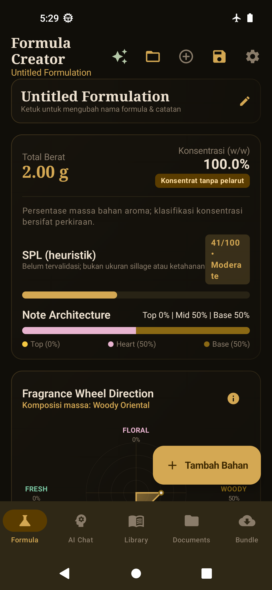 | 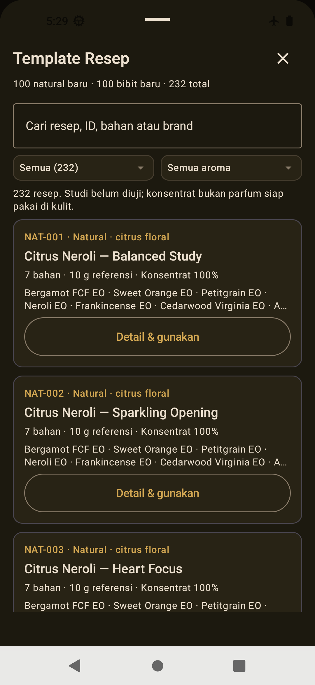 | 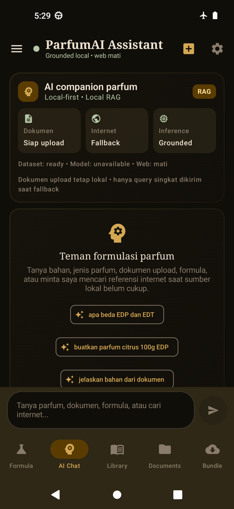 |
| Menghitung berat total, konsentrasi massa (w/w), indeks SPL heuristik, Note Architecture (Top/Heart/Base), serta diagram radar Fragrance Wheel 4-sumbu. | Menjelajahi 232 studi resep (100 natural `NAT-001`..`NAT-100`, 100 bibit `BIB-001`..`BIB-100`, 32 starter/legacy) dengan skala gram dan binding bahan katalog. | Asisten `ParfumAI` lokal-first dengan status tile Dokumen, Internet, dan Inference, saran pertanyaan cepat, sitasi dapat diklik, dan impor formula tervalidasi. |

| Menu Library (`IngredientLibraryScreen`) | Menu Documents (`DocumentsScreen`) | Menu Bundle (`DownloadScreen`) | Menu Pengaturan (`SettingsScreen`) |
| :---: | :---: | :---: | :---: |
| 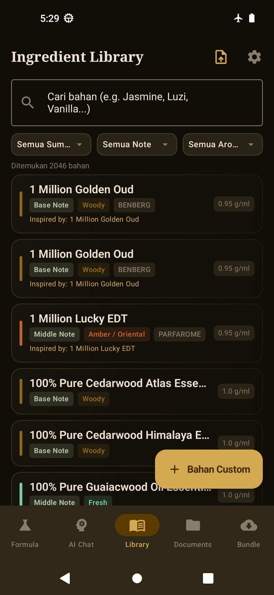 | 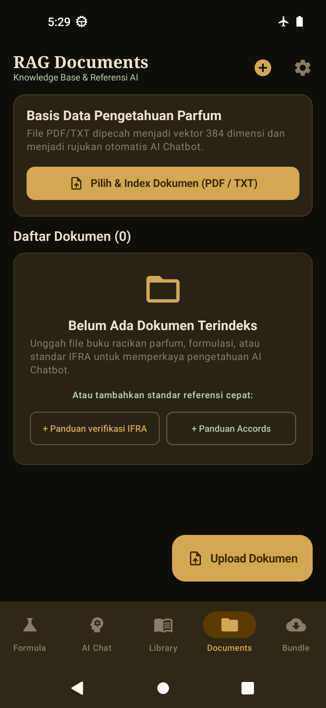 | 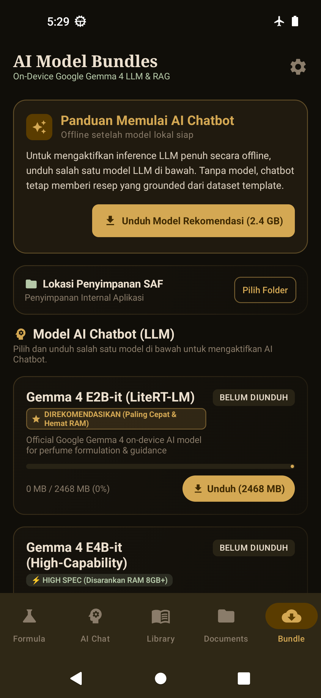 | 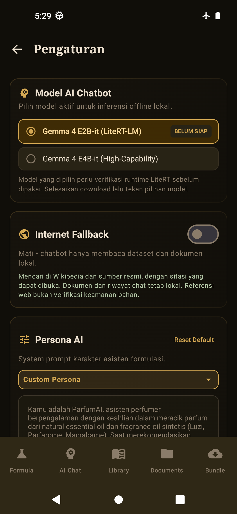 |
| Katalog 2.046+ bahan natural dan fragrance oil (Luzi, Parfarome, Macrabame, Benberg) dengan filter sumber, note, aroma, densitas g/mL, impor CSV, dan bahan custom. | Unggah dokumen PDF, TXT, MD, CSV, atau JSON via Storage Access Framework (SAF) untuk dipecah menjadi vektor 384-dimensi lokal. | Pengelola unduhan WorkManager resumable untuk model Google Gemma 4 E2B-it (`~2.4 GB`) dan E4B-it (`~3.4 GB`) dengan folder SAF dan verifikasi SHA-256. | Pilihan model LLM aktif, sakelar opt-in Internet Fallback (default mati), editor serta ekspor/impor Persona AI, pintasan Template Resep, dan satuan ukur default. |

## Fitur utama

- **Formula Creator & kalkulator terpadu**: Kelola formula menggunakan ID bahan katalog nyata untuk essential oil natural maupun fragrance oil bermerek dalam satu mesin kalkulasi (`FormulaCalculationEngine`). Mendukung konversi gram (`g`), miligram (`mg`), dan mililiter (`mL`) berbasis densitas katalog, kalkulasi konsentrasi massa (w/w), proporsi note (Top/Heart/Base), indeks SPL heuristik, serta radar chart Fragrance Wheel 4-sumbu (`FLORAL`, `WOODY`, `ORIENTAL`, `FRESH`).
- **232 template resep & binding katalog aman**: Jelajahi 100 studi konsentrat natural (`NAT-001` sampai `NAT-100`), 100 studi konsentrat bibit (`BIB-001` sampai `BIB-100`), dan 32 template starter/legacy. Pratinjau komposisi, skala gram batch, pemilihan produk katalog nyata untuk accord tanpa SKU, dan persetujuan adaptasi dijalankan sebelum draft Formula Creator diganti. Tidak ada substitusi diam-diam atau auto-save.
- **Katalog 2.046+ bahan parfum**: Telusuri bahan natural (minyak atsiri, absolut, isolat, pelarut) dan produk fragrance oil dari Luzi, Parfarome, Macrabame, dan Benberg. Mendukung penambahan bahan custom serta impor daftar bahan CSV melalui SAF.
- **RAG dokumen lokal (MiniLM 384-d & Room)**: Dokumen PDF, TXT, MD, CSV, atau JSON yang dipilih lewat SAF dipecah secara Unicode-safe, di-embed di perangkat memakai `all-MiniLM-L6-v2.tflite` (384 dimensi), disimpan di Room (`rag_chunks`), dan dicari melalui pemeringkatan hybrid dense + lexical disertai sitasi halaman dan berkas.
- **AI lokal Gemma 4 E2B/E4B (LiteRT-LM) & grounded fallback**: Unduh model `.litertlm` yang dipin dari Hugging Face melalui `DownloadWorker` resumable dengan validasi ukuran byte dan SHA-256. Saat model lokal belum tersedia, sistem tetap menghasilkan jawaban ekstraktif bersumber dari katalog, template, knowledge snapshot, dan dokumen lokal.
- **Internet fallback opt-in**: Mati secara default (`allowInternetFallback = false`). Saat diaktifkan di Pengaturan dan bukti lokal belum cukup untuk pertanyaan pengetahuan, `WikimediaInternetClient` mencari otomatis ke host HTTPS dalam allowlist (`id.wikipedia.org`, `en.wikipedia.org`, IFRA, FDA, EU CosIng) tanpa redirect otomatis. Query disanitasi agar riwayat percakapan, dokumen lokal, dan kredensial tidak pernah dikirim.
- **Keamanan aplikasi (OWASP MASVS-RESILIENCE & NDK C++17)**: Kalkulasi SPL/konsentrasi, deteksi anti-debugging (`ptrace` & `/proc/self/status` `TracerPid`), dan inspeksi hooking (`/proc/self/maps`) dikompilasi ke `libparfume_core.so` lintas ABI (`arm64-v8a`, `armeabi-v7a`, `x86`, `x86_64`), dilengkapi `AndroidKeyStoreCrypto` AES-256 GCM, `allowBackup="false"`, `usesCleartextTraffic="false"`, serta R8 minification pada build rilis.

Catatan formulasi: SPL adalah indeks heuristik aplikasi, bukan ukuran daya tahan, proyeksi, atau sillage di kulit. Kategori konsentrasi dan arah fragrance wheel berfungsi sebagai alat bantu peracikan. Dokumentasi pemasok dan densitas bahan aktual selalu menjadi acuan utama.

## Cara penggunaan

1. **Kelola bahan di Library**: Buka tab **Library** untuk menelusuri bahan, mencari produk *inspired-by*, menyaring berdasarkan sumber/note/aroma, menambah bahan custom, atau mengimpor CSV melalui ikon unggah di bilah atas.
2. **Buat formula manual atau dari Template Resep**:
   - Di tab **Formula**, ketuk **Tambah Bahan** untuk memilih bahan katalog, mengatur jumlah (`g`/`mg`/`mL`), dan memantau total berat, konsentrasi, SPL heuristik, serta Fragrance Wheel secara langsung.
   - Untuk memakai template, ketuk ikon **Template Resep** di kanan atas **Formula** (atau buka melalui **Settings > Template Resep**). Pilih **Detail & gunakan**, tentukan target batch dalam gram, hubungkan bahan yang belum terpetakan ke produk katalog nyata, centang persetujuan adaptasi bila ada penggantian, lalu tekan **Gunakan di Formula Creator**.
3. **Indeks dokumen referensi (RAG)**: Buka tab **Documents**, pilih berkas PDF/TXT/MD/CSV/JSON lewat SAF (atau tambahkan referensi cepat IFRA/Accords), lalu tunggu pengindeksan selesai.
4. **Konsultasi di AI Chat**: Buka tab **AI Chat** dan ajukan pertanyaan pengetahuan atau permintaan racikan, misalnya: `Buatkan parfum natural citrus 100 g EDP`, `Buatkan parfum dari bibit Luzi 50 g 20%`, atau `Jelaskan perbedaan EDP dan EDT menurut dokumen saya`. Formula rekomendasi yang valid dapat diimpor langsung ke Formula Creator.
5. **Unduh model LLM on-device (opsional)**: Buka tab **Bundle**, pilih folder penyimpanan permanen via SAF (`Pilih Folder`), unduh **Gemma 4 E2B-it** (~2.4 GB) atau **Gemma 4 E4B-it** (~3.4 GB), tunggu verifikasi SHA-256 dan runtime selesai, lalu pilih model aktif di **Pengaturan**.
6. **Atur Internet Fallback & Persona**: Buka ikon roda gigi **Pengaturan** untuk mengaktifkan atau menonaktifkan **Internet Fallback**, menyesuaikan atau mengekspor/mengimpor **Persona AI**, serta mengubah satuan ukur default.

## Arsitektur sistem

Aplikasi menerapkan **Clean Architecture + MVVM** dengan jembatan **JNI ke C++17 (Android NDK)** dan penyimpanan lokal-first berbasis Room + DataStore:

- `presentation`: Jetpack Compose + Material 3 screen, `ViewModel`, `StateFlow<UiState>`, dan navigasi 5 tab utama plus layar Pengaturan.
- `domain`: model domain murni Kotlin, kontrak repository, single-responsibility use case (`SendChatMessageUseCase`, `ApplyFormulaTemplateUseCase`, `ValidateRecommendedFormulaUseCase`), dan `FormulaCalculationEngine`.
- `data`: `ParfumeDatabase` (Room v3: `ingredients`, `formulas`, `formula_ingredients`, `rag_documents`, `rag_chunks`, `chat_sessions`, `chat_messages`, `downloads`), `SettingsRepositoryImpl` (DataStore), dan `RepositoriesImpl`.
- `core`: ekstraksi dokumen (`PdfTextExtractor`, `TextChunker`), embedder TFLite (`TfLiteEmbeddingService`), LLM runner (`LiteRtLmRunner`, `GroundedFormulaPlanner`, `GroundedEvidenceAnswer`), `DownloadWorker` (WorkManager SAF resumable), `WikimediaInternetClient`, `SecurityHardeningManager`, `AndroidKeyStoreCrypto`, dan `NativeSecurityBridge`.
- `cpp`: library native `libparfume_core.so` (`app/src/main/cpp/parfume_core.cpp`, CMake 3.22.1) dengan symbol visibility hidden dan stripping untuk build rilis.

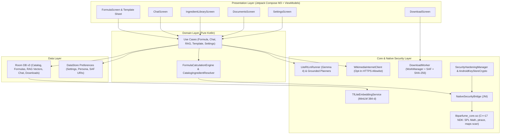

## Use case diagram

Diagram berikut merangkum interaksi aktor eksternal dengan delapan use case utama di dalam batas sistem aplikasi **ParfumCreator**:

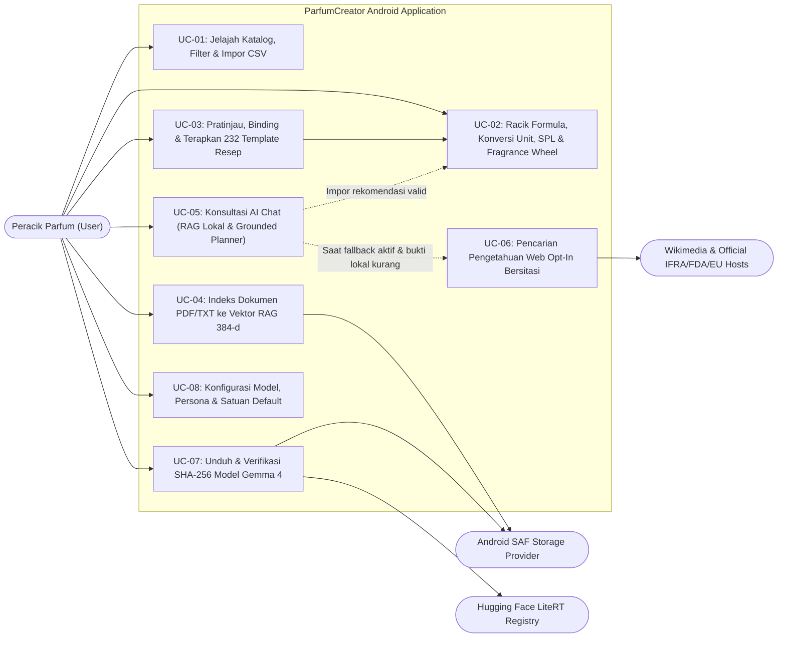

## Sequence diagram

### 1. Alur AI Chat, RAG lokal, dan Internet Fallback opt-in

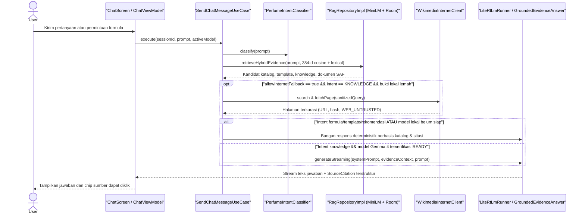

### 2. Alur kalkulasi formula & verifikasi native NDK (C++17)

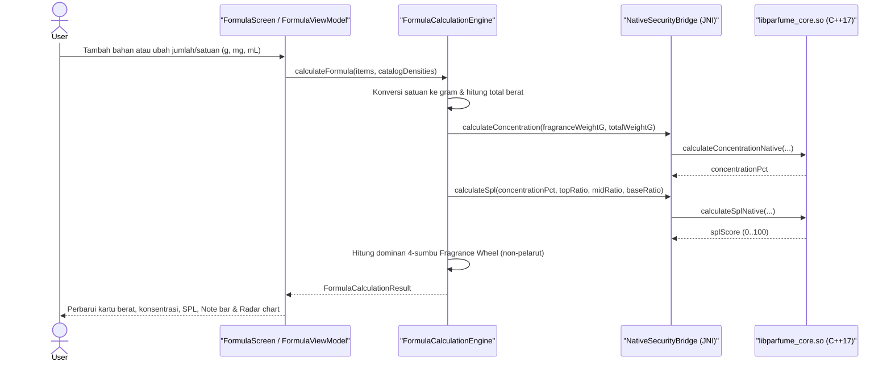

## Framework dan teknologi yang digunakan

Seluruh versi dependensi dikelola terpusat di [gradle/libs.versions.toml](gradle/libs.versions.toml) dan [app/build.gradle.kts](app/build.gradle.kts):

| Kategori | Teknologi / Library | Versi | Peran dalam aplikasi |
| --- | --- | --- | --- |
| **Bahasa & Build** | Kotlin, Android Gradle Plugin (AGP), KSP | `2.2.0`, `8.13.2`, `2.2.0-2.0.2` | Bahasa utama, build system, dan pemrosesan anotasi |
| **UI & Navigasi** | Jetpack Compose BOM, Material 3, Navigation Compose | `2025.05.00`, `2.9.0` | Antarmuka deklaratif Luxury Apothecary, animasi, dan navigasi |
| **Arsitektur & DI** | Dagger Hilt, Hilt Navigation Compose, Lifecycle Runtime | `2.58`, `1.2.0`, `2.8.3` | Dependency injection, `ViewModel`, dan observasi `StateFlow` |
| **Asinkron & Background** | Kotlin Coroutines, WorkManager | `1.8.1`, `2.9.1` | Konkurensi off-main dan pengunduhan model resumable latar belakang |
| **Persistensi Lokal** | Room (SQLite + KSP), DataStore Preferences, Android SAF | `2.7.1`, `1.1.1` | Penyimpanan katalog, formula, vektor RAG BLOB, riwayat chat, dan izin berkas |
| **AI & Embedding On-Device** | LiteRT-LM Android (`litertlm-android`), LiteRT (`litert`), MiniLM | `0.10.2`, `1.4.0` | Inferensi lokal Gemma 4 E2B/E4B dan embedding vektor `all-MiniLM-L6-v2.tflite` |
| **Parsing & Serialisasi** | PDFBox-Android, Gson | `2.0.27.0`, `2.11.0` | Ekstraksi teks PDF lokal serta parsing katalog/template JSON |
| **Native & Keamanan** | Android NDK (C++17), CMake, Android Keystore, R8 | C++17, CMake `3.22.1` | Library `libparfume_core.so`, AES-256 GCM hardware-backed, anti-debug/hook, obfuskasi |
| **Pengujian** | JUnit 4, Kotlinx Coroutines Test, Turbine, AndroidX Test & Espresso | `4.13.2`, `1.8.1`, `1.1.0`, `3.6.1` | Unit test JVM, pengujian `Flow`, dan instrumentasi Compose/Android |

## Bangun dan verifikasi

Prasyarat: JDK 17+ (teruji pada JDK 21), Android SDK platform 35 dan NDK/CMake 3.22.1, serta koneksi jaringan untuk resolusi dependensi Gradle pertama kali. Atur SDK melalui `ANDROID_HOME` atau berkas `local.properties` yang tidak dilacak Git.

```powershell
.\gradlew.bat :app:testDebugUnitTest
.\gradlew.bat :app:lintDebug
.\gradlew.bat :app:assembleDebug
# Dengan perangkat fisik atau emulator terhubung:
.\gradlew.bat :app:connectedDebugAndroidTest
```

Output APK debug berada di `app/build/outputs/apk/debug/app-debug.apk`. Laporan pengujian dan lint berada di `app/build/reports/`. Untuk alur pengujian emulator headless, lihat [panduan headless dev](android/HEADLESS_DEV_GUIDE.md).

## Keamanan, privasi, dan sumber data

Pengindeksan dokumen, pencarian vektor, dan kalkulasi berjalan secara lokal di perangkat. Saat Internet Fallback aktif, hanya teks pertanyaan saat ini yang telah disanitasi (tanpa URL, email, nomor telepon, atau pola kredensial) yang dikirim ke endpoint HTTPS allowlisted tanpa redirect otomatis; dokumen unggahan dan riwayat percakapan tidak pernah keluar dari perangkat.

200 studi resep bawaan merupakan konsentrat eksperimental (bukan parfum siap pakai di kulit, formula asli pemasok, atau klaim penghargaan terverifikasi). Slot accord LUZI dan Parfarome tanpa SKU selalu memerlukan pemilihan produk katalog secara manual, sedangkan bahan natural tidak diganti otomatis. Aplikasi ini tidak menetapkan batas dilusi aman atau izin IFRA; rincian asal aset dan batas metadata tercatat di [DATA_PROVENANCE.md](DATA_PROVENANCE.md).

## Dokumentasi & status verifikasi

- [Product Requirements Document](docs/PRD.md)
- [Design System](docs/DESIGN.md)
- [Data and Model Provenance](DATA_PROVENANCE.md)
- [Changelog](CHANGELOG.md)
- [Implementation and Verification Audit](IMPLEMENTATION_AUDIT.md)
- OpenSpec changes: [recipe-template-library](openspec/changes/recipe-template-library/proposal.md) ([spec](openspec/changes/recipe-template-library/specs/recipe-template-library/spec.md), [tasks](openspec/changes/recipe-template-library/tasks.md)), [mobile-app-hardening](openspec/changes/mobile-app-hardening/proposal.md), dan [native-ndk-hardening](openspec/changes/native-ndk-hardening/proposal.md).

Hasil gerbang otomatis (188 unit test di 19 suite lulus, Android lint 0 error, build Debug APK `v1.3.1` dengan SHA-256 terverifikasi) serta keterbatasan uji perangkat keras tercatat di [IMPLEMENTATION_AUDIT.md](IMPLEMENTATION_AUDIT.md). Build yang lolos kompilasi tidak menggantikan uji unduhan model multi-gigabita dan inferensi langsung di perangkat target.
